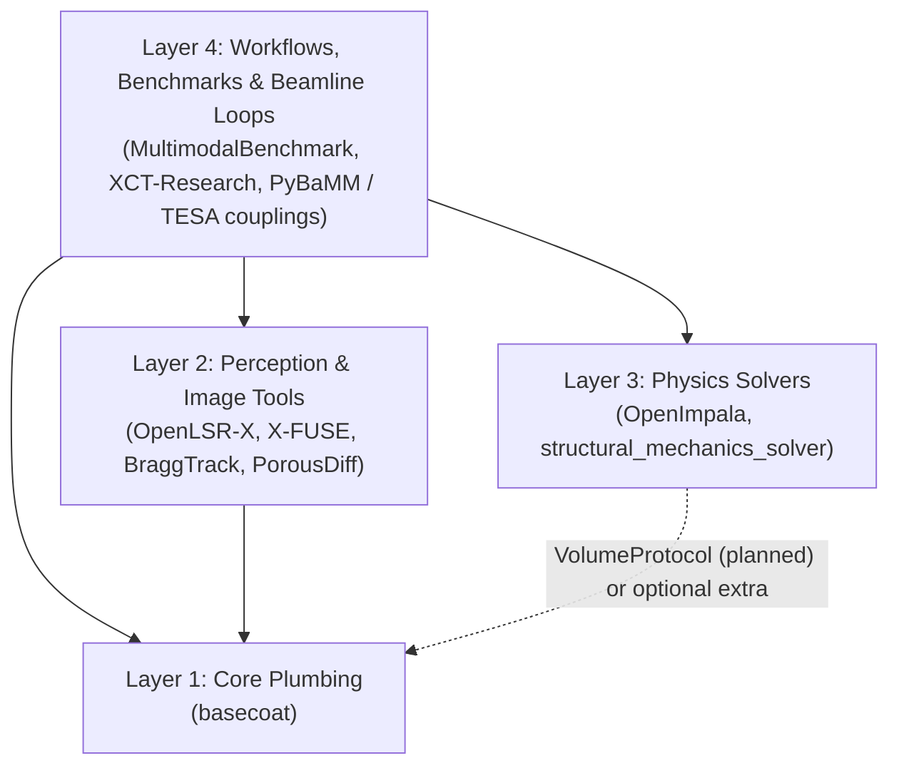

# BASE Lab image-based modelling ecosystem

Nov 20, 2026 · @James

## Purpose

This document sets where every piece of BASE Lab software lives, what it may depend on, and how the pieces exchange data. It is written for coding agents and group members working in any BASE Lab repository. Read it before adding a module, a dependency, a loader, or a dataset constant anywhere.

Status: draft v0.3, written 20 November 2026 from an audit of `MultimodalBenchmark` (`feat/benchmark-v2`), `OpenImpala` (`v5.0.0`), `OpenLSR-X`, `X-FUSE`, `BraggTrack`, `PorousDiff`, and `structural_mechanics_solver` (`feat/modernize-tests-python`). New repositories need James's approval.

How agents should use it:

- Treat sections marked as rules as binding. If a task would break one, stop and ask rather than working around it.
- Use the decision procedure ("Where does this code go?") to place new code. If two placements look equally valid, ask.
- Items under **Open decisions** are not settled. Do not implement against them without confirmation.
- **Single source of truth:** The canonical copy of this file lives in `BASE-Laboratory/basecoat/ECOSYSTEM.md`. Do not copy the full text into other repositories (copies drift). Each downstream repository carries a short pointer and layer declaration in its `CLAUDE.md` / `AGENTS.md`.

---

## Layers and the dependency rule

The ecosystem has four layers, and imports only ever point down. A tool never imports another tool, a solver never imports a tool or another solver, and nothing imports a workflow.

Workflows may import anything below them. Tools and solvers depend only on `basecoat` (or duck-type its `VolumeProtocol` without importing `basecoat`), and pass volumes to each other as contract files or in-memory `Volume` objects orchestrated by Layer 4.

1. **Layer 1 — Core (`basecoat`):** Shared plumbing that passes the two-consumer admission rule. In `v0.1`: `Volume`, `VolumeSet`, `AxisSpec`, `LazyVolume`, `VolumeProtocol`, OME-Zarr v0.4 (image + labels), HDF5 / TIFF / raw I/O, `AffineTransform3D` + `SimilarityTransform3D` + resampling, and SHA-256 fetching. Facility readers, uncertainty sidecars, filters, HDF5 solver staging, and the config-driven layer linter enter `basecoat` only as their second consumer migrates.
2. **Layer 2 — Perception and image tools:** Methods that turn detector or image volumes into reconstructed volumes, phase segmentations/uncertainties, or tracked feature graphs. `OpenLSR-X`, `X-FUSE`, `BraggTrack`, `PorousDiff`.
3. **Layer 3 — Physics solvers:** Methods that turn a labelled or fractional volume into fields and effective properties. `OpenImpala` (transport), `structural_mechanics_solver` / `SMS` (mechanics).
4. **Layer 4 — Workflows, benchmarks, and services:** Code tied to a dataset, an experiment, a coupled pipeline, or user-facing cataloguing/visualisation. `MultimodalBenchmark`, `XCT-Research` (DIAD trigger), `DFXM-Topographic-Origins`, `datalab-app-xrayct`, `OperandoCellLibrary`, `BatteryExplorer`, and external `PyBaMM` / `TESA` couplings.

### Dependency rules (binding)

- **Layer 2** packages may depend on `basecoat`, and on nothing else in the BASE Lab ecosystem.
- **Layer 3** solvers keep standalone installability where needed (`pip install openimpala` requires zero BASE Lab packages). Planned integration (`OpenImpala v5.1`, `SMS` modernisation branch) accepts any object satisfying `VolumeProtocol` at the Python boundary without requiring `basecoat` at runtime (with an optional `openimpala[basecoat]` extra for `.ome.zarr` path convenience). Solvers never import Layer 2 tools or other Layer 3 solvers.
- **Layer 4** workflows may depend on anything in Layers 1–3.
- **No lateral imports:** Tools and solvers exchange data through files that follow the data contract or through `Volume` objects passed by a Layer 4 caller, never by importing each other. A helper such as `export_for_openimpala` inside another tool is a sign this rule was broken.
- **Nothing depends on Layer 4:** No Layer 1, 2, or 3 package may import or list `multimodal-benchmark`, `xct-research`, or any other Layer 4 repo as a dependency.
- **`basecoat` stays light:** Required dependencies of `basecoat` are strictly `numpy`, `scipy`, `h5py`, `tifffile`, `zarr` (`>=2.16,<3`), and `numcodecs`. `torch`, `scikit-image`, `dask`, `ome-zarr`, `Pillow`, `mpi4py`, `AMReX`, `SimpleITK`, and `rosettasciio` are never required by `basecoat`; `SimpleITK` and `rosettasciio` may appear only behind optional extras.

---

## Repo registry

Each repo owns one job. The "Must not contain" column lists what agents should migrate out when touching a repo, never add to. New repositories need James's approval.

| Repo | Layer | Owns | Must not contain | Maintainer | Status |
| :--- | :--- | :--- | :--- | :--- | :--- |
| **`basecoat`** | 1 Core | `v0.1`: `Volume`, `VolumeSet`, `AxisSpec`, `LazyVolume`, `VolumeProtocol`; OME-Zarr v0.4 (image + labels), HDF5, TIFF, raw I/O; `AffineTransform3D`, `SimilarityTransform3D` & resampling; SHA-256 fetch/cache. *Planned on 2nd consumer:* facility readers, sidecars, artefact filters, HDF5 staging, layer linter | Dataset constants, scan IDs, method/model code, heavy required dependencies, downstream repo names | James | Building `v0.1.0` |
| **`OpenImpala`** | 3 Solver | AMReX/HYPRE transport solves; effective diffusivity, tortuosity, SSA, volume fraction, percolation; solver-native C++ readers in `src/io`; Python facade; PyBaMM & BPX helpers. *Planned (`v5.1` branch):* `VolumeProtocol` & optional `.ome.zarr` input | Dataset loaders, ML code, `basecoat` runtime import in core `openimpala` | James | `v5.0.0` released Nov 2026, JOSS paper. Public API changes need James |
| **`structural_mechanics_solver` (`SMS`)** | 3 Solver | Voxel finite-volume linear elasticity (Fortran, MPI); effective modulus; strain/displacement fields; Python bindings. *Planned:* `VolumeProtocol` / contract `.ome.zarr` reader at Python boundary | XCT preprocessing, TESA-specific code, dataset constants | Peter Soar (to confirm) | Modernising on `feat/modernize-tests-python` |
| **`OpenLSR-X`** | 2 Tool | Super-resolution models, training, inference, SR-specific losses and metrics | Zn-13X constants (`data/zn13x.py`, `zn13x_certified_regions.yaml`), generic readers, registration, `export_for_openimpala` | James | Strong beta, *npj* manuscript in prep |
| **`X-FUSE`** | 2 Tool | Correlative fusion models, conformal uncertainty, fusion heads | Zn-13X & DIAD loaders, the $47.5^\circ$ offset, de-ringing/cupping code, generic readers, `export_for_openimpala` | James | `v1.0` candidate (licence to be settled before lifting any code) |
| **`BraggTrack`** | 2 Tool | Bragg spot segmentation, multi-frame tracking, lineage, DFXM triggers, `ImageD11` / `NXprocess` export | Dataset constants, generic readers once `basecoat` facility readers land | James | `v0.5`, JOSS submission |
| **`PorousDiff`** | 2 Tool | Conditional diffusion for microstructures | — | Asif (archive) | Parked |
| **`MultimodalBenchmark`** | 4 Workflow | Zn-13X manifest & errata, fitted transforms, ruby metrology, splits, task specs, evaluator, tool adapters, derived release packaging, the benchmark paper | Model implementations; generic I/O & transforms once switched to `basecoat` | James | `v2` on `feat/benchmark-v2` (first `basecoat` consumer) |
| **`XCT-Research`** | 4 Workflow | DIAD image-subtraction trigger and replay harness | Reusable tools (graduate to Layer 2 once proven and approved) | Mizanur | Scaffold |
| **`DFXM-Topographic-Origins`** | 4 Workflow | Paper notebooks & FEA scripts for NMC811 single-crystal DFXM study | Reusable tracking code (lives in `BraggTrack`) | James | Published preprint archive |
| **`datalab-app-xrayct`**, **`OperandoCellLibrary`**, **`BatteryExplorer`** | 4 Service | FAIR NeXus cataloguing; sample-environment registry; 4D operando dashboard | — | James | Maintained as needed |
| **`TESA`** | External | Peter and Matt's coupled models | — | Peter, Matt | Consumes and produces data through the contract |

---

## The data contract

The contract is deliberately light. It has four invariants that **always** hold, and a table of defaults you can depart from when the work needs it. Where you depart, say so in the code, metadata, or README.

### Always

1. **Say what you've got.** A `Volume` holds **one** array plus its `AxisSpec` tuple (`name`, `kind`, `unit`, `scale`, `offset`), stating its physical unit (`"um"`, `"m"`, etc.) or explicitly stating `"voxel"` when uncalibrated. Labelled volumes carry an integer-to-meaning map. Co-registered layers (an image plus named label masks, and later uncertainty/probability arrays) travel in a `VolumeSet`, not as extra array attributes stuffed onto `Volume`.
2. **Convert in one named place.** Changes between voxel and physical units, between axis orders, or between label schemes happen in an explicit function or method (`vol.spacing_in("m")`, `tx.to_sitk()`), never by guessing or by nominal magnification ratios. Calling `spacing_in("m")` on an uncalibrated `"voxel"` volume raises an error explaining how to supply spacing.
3. **Transforms say which way they go.** Every stored or in-memory transform records `from_space`, `to_space`, `unit` (`"um"` or `"voxel"`), and `axis_order`.
4. **Don't load what you don't need.** Readers support region reads (`open_volume` $\rightarrow$ `LazyVolume.read_region`). `LazyVolume` never silently materialises a full multi-GB dataset into RAM.

### Defaults

| Topic | Default | Fine to depart when |
| :--- | :--- | :--- |
| **Units** | `"voxel"` within one uncalibrated grid; **`"um"` (micrometres)** when two grids meet (registration, resampling between resolutions, cross-beamline comparison) or in shared `.ome.zarr` files | A tool or solver's natural unit differs (`OpenImpala`'s solver takes metres; `BraggTrack` uses `deg` and `angstrom`). Convert at its boundary |
| **Grid coordinate convention** | **Cell-centre at index `0`:** `AxisSpec.offset` is the physical coordinate of the **centre** of voxel `0`, so voxel `i` has its centre at `offset + i * scale` (matching SimpleITK `Origin` and `napari` `translate`). Coarsening by factor `k` shifts the coarse level's index-`0` centre to `offset + 0.5 * (k - 1) * scale` | A staggered finite-volume solver needs face or node coordinates; record `centering="face_x" \| "node"` |
| **Axis order** | `(z, y, x)` for 3D NumPy and OME-Zarr; `(y, x)` for 2D slices | A Fortran or C++ solver works in `(x, y, z)`. It documents how direction names map to axes and uses zero-copy views (`arr.T`) rather than copying large arrays |
| **Bit depth** | Highest available for quantitative work (`float32` reconstructions, `uint16`/`uint32` raw counts). Never compare volumes windowed or rescaled independently | Previews, figures, quick registration checks (mark as preview) |
| **Labels and masks** | Integer labels with a documented meaning; downsampled label pyramid levels use the **mode** (most common label, smallest ID on ties), never the mean | Fractional masks (e.g. `SMS` solid fraction), when documented |
| **Transforms** | Pullback affine/similarity convention (**maps fixed / output points $\rightarrow$ moving / input points**), matching `SimpleITK.ResampleImageFilter` and `scipy.ndimage.affine_transform` | Forward point kinematics (`t -> t+1` trajectories); store `from_space` and `to_space` explicitly |
| **Files** | OME-Zarr v0.4 for archive and sharing; chunked HDF5 for multi-node MPI solver input (`OpenImpala`'s C++ readers); TIFF for small standalone volumes | A consumer or online loop needs another format or in-memory `Volume` handoff |
| **Chunking & compression** | Typically `64`–`256` voxels per side (e.g. `128³`) with lossless `Blosc` (`zstd`, bitshuffle), chosen to suit the access pattern | Slice-wise access, uncompressed fast scratch, or MPI domain decomposition needs otherwise |
| **Field outputs** | State where values sit (`cell` centres, `face`, or `node`). Exchange cell-centred fields by default | A consumer needs native staggered fields (`SMS` displacements) |
| **Provenance** | Record source, `basecoat` version, git SHA, data precision, and processing steps on outputs that feed reported results | Scratch work, exploration |

---

## Where does this code go?

Work through these questions in order and **stop at the first yes**:

1. **Does it mention a specific sample, scan ID, DOI, beamline visit, or fitted value?**
   It goes in the Layer 4 workflow repo for that dataset or experiment (`Zn-13X` $\rightarrow$ `MultimodalBenchmark`; the DIAD loop $\rightarrow$ `XCT-Research`). This includes fitted transforms, scan tables, motor offsets such as the $47.5^\circ$ correction, and frozen preprocessing parameters.
2. **Does it couple two or more tools or solvers, or run an experiment end to end?**
   Layer 4: a workflow repo.
3. **Is it a physics solve on a labelled or fractional volume?**
   The solver for that physics. Transport goes in `OpenImpala`, elasticity in `SMS`. A new physics with no home goes on the **Open decisions** list, not into a new repo.
4. **Is it the method a tool exists for (a model, a loss, a fusion head, a tracker)?**
   That tool.
5. **Is it plumbing (reading, writing, resampling, fetching, generic filtering)?**
   Check the **`basecoat` admission rule** below. If it passes, it goes in `basecoat`. If not, it stays private inside the one repo that needs it, with a leading underscore (`_helper.py`), until a second consumer needs it.

### `basecoat` admission rule (the two-consumer rule)

Code enters `basecoat` **only if all five hold**:
- **Two consumers:** At least two tools, solvers, or workflows need it now (one consumer keeps it private with an underscore prefix until the second consumer migrates).
- **Zero dataset constants:** No scan IDs, Zenodo record numbers, or sample-specific thresholds.
- **Not a tool's method:** No learned models, training loops, or solver-specific PDE kernels.
- **Light dependencies:** Required dependencies stay within `numpy`, `scipy`, `h5py`, `tifffile`, `zarr` (`<3`), and `numcodecs`. Anything heavier sits behind an optional extra.
- **Clear licence & credit:** Source code being lifted has a compatible BSD-3-Clause licence (do **not** lift code from `X-FUSE` until its licence is settled) and credits original authors in `CITATION.cff` and module docstrings.

`basecoat` keeps an explicit `__all__` guarded by a contract test and follows semantic versioning. Public API changes need James's approval.

---

## Hard rules for agents

These rules come from failures found in the November 2026 audit. Breaking one needs James's explicit approval in the task.

### Structure
- **Follow the two-consumer rule rather than copying across repos.** Do not copy a module from one repo into another. If a second repo now needs an existing private helper (and its licence is settled), extract it cleanly into `basecoat` with tests and author credit; otherwise ask first.
- **Do not put dataset constants in a tool or solver.** When you find one, list it for migration rather than editing around it.
- **Do not import one tool or solver from another, and do not add a dependency on any Layer 4 repo.** When the layer linter lands, each repo declares its own layer and banned imports in `[tool.basecoat.layers]` inside its `pyproject.toml` (`basecoat` never hardcodes downstream package names).
- **Do not change `OpenImpala`'s public Python API or C++ interfaces without James.**

### Honesty of outputs
- **Every command, CLI subcommand, or function named in a script, config, README, or paper must exist.** Run it, or at least `--help`, before committing.
- **Every reference in a `.bib` file needs a DOI or arXiv ID that you have opened.** No `"and others"` author lists in place of real authors.
- **Results files state what data they were computed on** (`8-bit preview`, `32-bit float`, `synthetic`). Placeholders are marked as `"pending"`, never filled with plausible numbers.
- **Physics, geometry, and filter code needs analytical or reference tests** (a known closed-form solution, a symmetry, cell-centre invariance, or MPI-rank invariance following `SMS` and `OpenImpala`). Filter tests assert edge sharpness and chemistry retention *first* with conservative artefact suppression as a floor—never aggressive variance-drop targets that strip real signal.
- **Report honestly at the end of every session:** state what was run, what passed, and what was not tested. Never write example outputs or benchmark numbers that were not produced by an actual run. James checks all validation outputs before they are reported.

### Versions and releases
- Pin direct ecosystem dependencies with an upper bound (`basecoat>=0.1,<0.2`, `openimpala>=5.0,<6.0`).
- Each repo names one maintainer in its `README.md`.
- Commit messages describe what changed in plain words. One logical change per commit.

---

## Known duplication and staged migration

The audit found the same job done in up to four places, with copies already disagreeing (`OpenLSR-X`'s Zn-13X file gives Rung 1's ratio as `1.6023×` vs `MultimodalBenchmark`'s `1.6039×`). Migration happens **one repository per PR**, only after `basecoat v0.1` is built and tested standalone.

| Capability | Where it is now | Target home & timing |
| :--- | :--- | :--- |
| **Generic volume I/O & OME-Zarr (image + labels)** | `OpenImpala` `_io.py`, `OpenLSR-X` `load_volume_any`, `X-FUSE` `io.py`, `MultimodalBenchmark` `io.py` & `write_ome_zarr_v04` | **`basecoat v0.1`** (`OpenImpala` keeps its C++ readers & standalone pure-Python fallback) |
| **3D similarity/affine transforms & resampling** | `MultimodalBenchmark` `registration/i13_ladder.py`, `OpenLSR-X` `data/zn13x.py`, `X-FUSE` `registration.py` | **`basecoat v0.1`** (verified empirically against `MultimodalBenchmark`'s `SimpleITK` resampler) |
| **Download, cache & SHA-256 checksum** | `OpenImpala` `datasets.py`, `OpenLSR-X` (two copies), `X-FUSE` `datasets.py` | **`basecoat v0.1`** |
| **Hand-off to `OpenImpala`** | `export_for_openimpala` in `OpenLSR-X` and `X-FUSE` | **Deleted as each tool migrates.** `OpenImpala v5.1` branch adds `VolumeProtocol` / optional `.ome.zarr` support |
| **Savu, NeXus, DAWN, BLISS & Rigaku readers** | `MultimodalBenchmark` `io.py`, `X-FUSE` `loaders.py`, `OpenLSR-X` `extract_aligned_slab_from_h5`, `BraggTrack` `io/` | **`basecoat` (`v0.2+`)**, added as the second consumer migrates (after `X-FUSE` licence is settled if any `X-FUSE` code is referenced) |
| **Ring removal & cupping detrend** | `MultimodalBenchmark` `preprocessing/artifact_cleanup.py`, `X-FUSE` `loaders.py` | **Algorithm in `basecoat` (`v0.2+`)** when second consumer migrates; frozen parameters stay in `MultimodalBenchmark` |
| **Probability, uncertainty & conformal sidecars** | `OpenLSR-X` (`sigma_ortho`), `X-FUSE` (`VolumetricUncertaintyReport`) | **`basecoat.VolumeSet` extension (`v0.2+`)** when `OpenLSR-X` and `X-FUSE` migrate |
| **Zn-13X scan tables, DOIs, fitted transforms, $47.5^\circ$ offset** | `MultimodalBenchmark`, `OpenLSR-X` `data/zn13x.py` & `zn13x_certified_regions.yaml`, `X-FUSE` `datasets.py` & `loaders.py` | **`MultimodalBenchmark` only** |
| **Benchmark adapters for `OpenLSR-X` & `X-FUSE`** | `MultimodalBenchmark` `baselines/integrations/` | **Rewritten in `MultimodalBenchmark`** against each tool's real CLI/API |

### Migration sequence

1. **Session 1 (`basecoat v0.1.0` standalone):** Build and test `basecoat` on its own. Do **not** touch `OpenImpala`, `OpenLSR-X`, `X-FUSE`, `MultimodalBenchmark`, or `SMS` in the same session.
2. **First consumer (`MultimodalBenchmark` branch):** Switch `MultimodalBenchmark`'s volume I/O, OME-Zarr writer, and 7-DOF resampling onto `basecoat`. **Gate:** Stage 0 and T2/T4 numbers in its results JSON files must reproduce within stated numerical tolerance.
3. **Solver boundary PRs (separate branches, one repo at a time):**
   - `OpenImpala` (`v5.1` feature branch, requires James's sign-off): accept `VolumeProtocol` with `OpenImpala`'s own unit-error exception (no `basecoat` runtime import).
   - `SMS` (`feat/modernize-tests-python` follow-up): accept contract OME-Zarr / `VolumeProtocol` at its Python boundary so `MultimodalBenchmark` can score stiffness alongside tortuosity.
4. **Layer 2 tool cleanups (one repo per PR, existing test suites staying green):** Remove Zn-13X constants and `export_for_openimpala` from `OpenLSR-X` and (once its licence is settled) `X-FUSE`, migrating shared facility readers/filters/sidecars into `basecoat v0.2` as the second consumer arrives.

---

## Physics solvers

Transport and mechanics stay in separate solvers for now and couple through contract files. In-memory coupling is a Horizon 3 decision.

- **`OpenImpala`** owns transport physics: diffusion, tortuosity, effective conductivity, and later impedance. Its scope grows only by James's decision.
- **`SMS`** owns linear elasticity. It is the validated reference implementation for mechanics, with analytical and MPI-invariance tests. Its link to `TESA` is through the data contract.
- **Coupling now** is one-way and file-based. Both solvers take the same labelled OME-Zarr volume (once their `VolumeProtocol` / `.ome.zarr` boundary branches land) and write fields on the same grid. The first joint use is in `MultimodalBenchmark`, scoring whether image processing steps alter stiffness as well as tortuosity.
- **In-memory chemo-mechanics later (Horizon 3):** Diffusion-induced swelling stress on one grid would require an elasticity operator built on AMReX inside `OpenImpala`, using `SMS` as its test oracle. Agents must not start this before James and Peter settle it.
- **Benchmark before porting:** Compare `SMS`'s finite-volume solver, an AMReX multigrid operator, and FFT-based homogenisation (Moulinec–Suquet / rotated-stencil type, e.g. `AMITEX_FFTP`) on identical porous volumes—including zero-stiffness void phase ($E_{\text{pore}} = 0$)—for speed and agreement.

---

## Open decisions

Agents do not implement against these until they are settled here.

- [ ] **Licence of `X-FUSE`:** Currently `MIT` in-repo vs `BSD-3-Clause` across the rest of `BASE-Laboratory`. Settle before lifting any `X-FUSE` code into `basecoat`.
- [ ] **Long-term maintenance of `basecoat`:** James initially; decide whether an RSE post is costed into the next major grant to own it.
- [ ] **Maintainer of `SMS`:** Peter, James, or shared.
- [ ] **`SMS` Python boundary conventions:** Confirm `SMS`'s native units for `dx` and field centering (`node` vs `face` vs `cell`) on `feat/modernize-tests-python`.
- [ ] **Horizon 3 elasticity path:** Whether elasticity enters `OpenImpala` on AMReX after the `SMS` vs AMReX vs FFT solver comparison.
- [ ] **`TESA` exchange format:** Whether `TESA`'s fields sit on regular Cartesian grids that fit the OME-Zarr contract directly.
